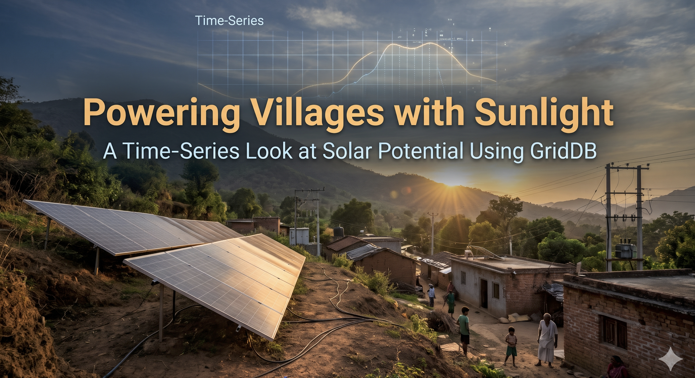
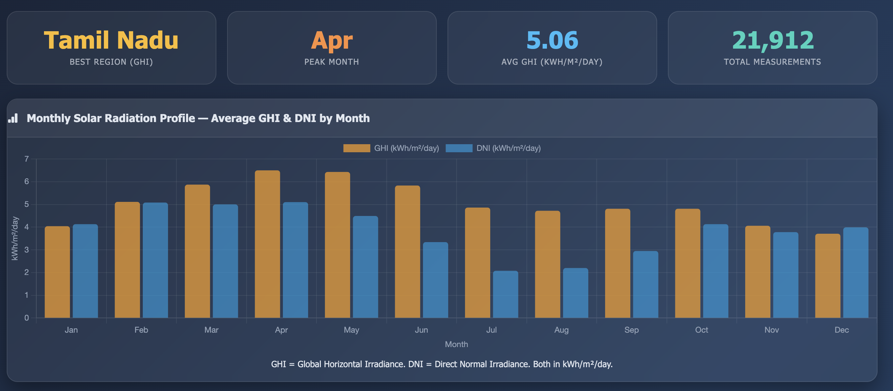
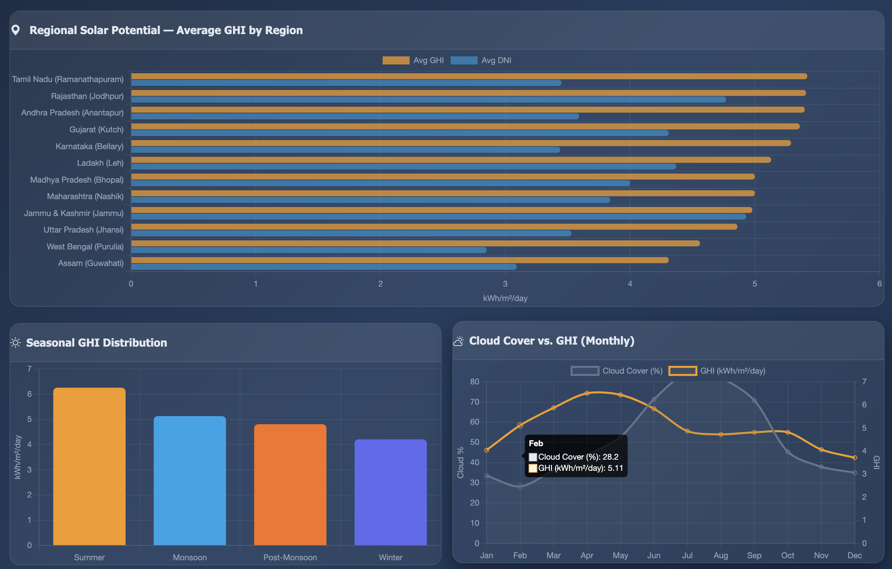
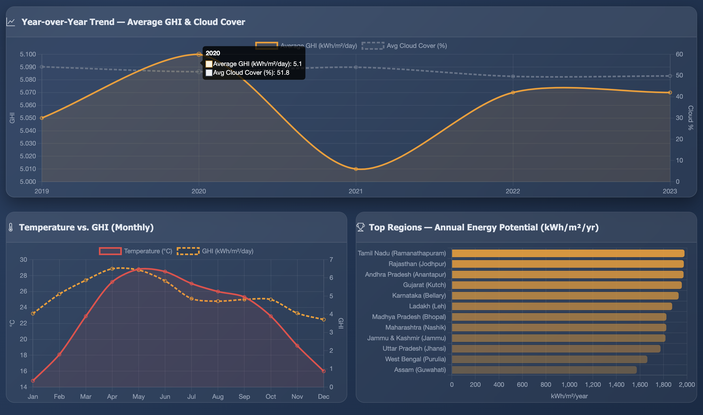

# Powering Villages with Sunlight: A Time-Series Look at Solar Potential Using GridDB



## Introduction

Rural electrification through solar micro-grids requires empirical assessment of regional solar resources. Before deploying photovoltaic hardware in an off-grid village, energy planners must answer concrete engineering questions: what is the seasonal floor for daily generation? By what margin does summer generation collapse during the monsoon? How much battery buffer is required to bridge prolonged cloudy intervals?

Answering these questions demands multi-year, daily time-series records of surface solar irradiance across candidate regions. A single geographic coordinate tracked daily across five years produces 1,826 records. Expanding that footprint across twelve representative administrative districts yields a dataset of 21,912 time-indexed meteorological observations containing Global Horizontal Irradiance (GHI), Direct Normal Irradiance (DNI), 2-meter air temperature, and cloud fraction.

When evaluating time-series data at this resolution, relational engines often struggle with broad multi-year range scans and time-bucket grouping across millions of rows. This article demonstrates an end-to-end data engineering and analytics pipeline built with **GridDB Cloud** (provisioned via the **Microsoft Azure Marketplace**), a **Spring Boot 3** service, and a **Chart.js** dashboard. The pipeline ingests 5 years of daily satellite-derived solar radiation measurements from the **NASA POWER** (Prediction Of Worldwide Energy Resources) archive, indexes them into a high-throughput time-series container, executes database-side SQL aggregations, and visualizes the results.

---

## Solar Radiation Metrics and Data Model

### Physical Irradiance Parameters

Photovoltaic energy yield calculations depend on two primary radiative components:

- **GHI (Global Horizontal Irradiance):** The total geometric sum of direct solar beam and diffuse sky radiation received on a horizontal surface, expressed in kWh/m²/day. This is the fundamental benchmark for fixed-tilt rooftop and ground-mounted solar installations prevalent in rural micro-grids.
- **DNI (Direct Normal Irradiance):** The radiation component received perpendicular to the solar vector. DNI excludes diffuse radiation and drops sharply during cloudy conditions, making it the primary metric for tracking collectors and concentrated solar thermal setups.
- **Surface Cloud Amount (CLOUD_AMT):** Fractional cloud cover (0.0 to 1.0) derived from satellite radiometers, used to evaluate radiative attenuation.
- **Air Temperature (T2M):** Ambient temperature at 2 meters above ground. High temperatures induce negative thermal coefficients on crystalline silicon panels (typically -0.35% to -0.45% efficiency loss per °C above 25°C), making simultaneous irradiance and temperature tracking essential.

### GridDB Container Schema Design

GridDB's `TIME_SERIES` container type models time-indexed observations with sub-millisecond query performance and automatic chronological compression. The container schema is structured as follows:

| Column | GridDB Type | Description |
| :--- | :--- | :--- |
| `timestamp` | `TIMESTAMP` | Measurement timestamp (row key, unique per region-day) |
| `regionId` | `STRING` | Short identifier (e.g., `RAJ`, `GUJ`, `TN`, `LAD`) |
| `regionName` | `STRING` | District and state description |
| `latitude` | `DOUBLE` | Site latitude (decimal degrees) |
| `longitude` | `DOUBLE` | Site longitude (decimal degrees) |
| `ghiKwhM2Day` | `DOUBLE` | All-sky Surface Downward Irradiance (kWh/m²/day) |
| `dniKwhM2Day` | `DOUBLE` | Direct Normal Irradiance (kWh/m²/day) |
| `temperatureCelsius` | `DOUBLE` | Ambient temperature at 2m height (°C) |
| `cloudCoverFraction` | `DOUBLE` | Normalized cloud cover fraction (0.0 to 1.0) |
| `month` | `INTEGER` | Calendar month index (1–12) |
| `year` | `INTEGER` | Calendar year (2019–2023) |
| `season` | `STRING` | Season partition (`Summer`, `Monsoon`, `Post-Monsoon`, `Winter`) |

### Row Key Determinism and Uniqueness

GridDB `TIME_SERIES` containers enforce that every record possess a strictly unique `TIMESTAMP` primary key. Because solar datasets contain observations across multiple geographic regions for the same calendar date, a natural collision occurs if records are indexed purely at midnight.

To maintain idempotent bulk loading without key collisions, each region is assigned a deterministic sub-day hour and millisecond offset derived from its geographic array index:

```text
timestamp = Date(year, month, day) + (regionIndex * 1 hour) + ((day * 1000 + regionIndex) % 1000) milliseconds
```

Because regional queries aggregate at daily, monthly, and seasonal boundaries, this deterministic sub-day displacement does not distort analytical aggregates while ensuring that repeated ingestion runs overwrite existing keys rather than duplicating records.

---

## Architecture Overview

```
┌────────────────────────────────────────────────────────┐
│     NASA POWER API (Satellite Observations)            │
│     12 Districts × 1,826 Days = 21,912 Records         │
└───────────────────────────┬────────────────────────────┘
                            │
                            ▼
┌────────────────────────────────────────────────────────┐
│ Ingestion Layer (Spring Boot 3)                        │
│ - NasaPowerClientService (Pure Java NASA API client)   │
│ - SolarDataIngestionService (Staged CSV parser)        │
│ - DataInitializerService (Idempotent orchestration)   │
└───────────────────────────┬────────────────────────────┘
                            │  HTTP PUT (2,000 rows/batch)
                            ▼
┌────────────────────────────────────────────────────────┐
│ Storage Layer (GridDB Cloud on Azure)                  │
│ - Container: solar_radiation_records                   │
│ - Type: TIME_SERIES                                    │
│ - In-engine SQL aggregations                           │
└───────────────────────────┬────────────────────────────┘
                            │  SQL aggregations (JSON)
                            ▼
┌────────────────────────────────────────────────────────┐
│ Presentation Layer (Spring Boot + Chart.js)            │
│ - SolarAnalyticsController (REST Endpoints)            │
│ - Thymeleaf Dashboard (Responsive Visualization)       │
└────────────────────────────────────────────────────────┘
```

1. **Data Source:** Daily satellite observations covering January 1, 2019 through December 31, 2023 sourced from the NASA Langley Research Center POWER Project for twelve rural districts across India.
2. **Ingestion Service:** Automatically checks GridDB container row count on startup; if empty, parses the staged CSV dataset and streams batched HTTP PUT requests to the GridDB Web API in chunks of 2,000 rows.
3. **GridDB Cloud Storage:** The cloud-managed instance stores the time-series records. All grouping, averaging, and cross-column comparisons execute natively inside GridDB via its SQL engine.
4. **REST and Dashboard Layer:** Spring Boot exposes analytical JSON endpoints consumed by a client-side Chart.js dashboard providing comparative charts and summary KPIs.

---

## GridDB Cloud Provisioning and Connectivity

GridDB Cloud on Azure provides an enterprise managed cluster fronted by an Azure Application Gateway.

### Configuration Properties

The application parameters are externalized in `application.properties`:

```properties
griddb.base-url=${GRIDDB_BASE_URL:https://<cluster-host>/griddb/v2/<cluster-name>/dbs/<database>}
griddb.username=${GRIDDB_USER:your_contract_id-your_username}
griddb.password=${GRIDDB_PASSWORD:your_password}
griddb.container-name=${GRIDDB_CONTAINER:solar_radiation_records}
solar.data.dir=${SOLAR_DATA_DIR:src/main/resources/data}
```

### Network Security and Basic Authentication

The GridDB Cloud Web API authenticates requests using HTTP Basic authentication using database user credentials formatted as `ContractID-Username`. The connection requires client IP allowlisting in the GridDB Cloud Management Portal (**Connection Settings → IP Allowlist**) to prevent Azure Application Gateway HTTP 403 rejections.

---

## Implementation Details

### Data Model: SolarRecord

The application uses Java 17 records to model immutable meteorological tuples:

```java
public record SolarRecord(
        LocalDateTime timestamp,
        String regionId,
        String regionName,
        double latitude,
        double longitude,
        double ghiKwhM2Day,
        double dniKwhM2Day,
        double temperatureCelsius,
        double cloudCoverFraction,
        int month,
        int year,
        String season
) {}
```

### Ingestion Service: SolarDataIngestionService

The ingestion service reads the formatted NASA POWER CSV dataset using Apache Commons CSV, converts timestamp strings into `LocalDateTime`, and validates measurement ranges:

```java
@Service
public class SolarDataIngestionService {

    private static final Logger log = LoggerFactory.getLogger(SolarDataIngestionService.class);

    public List<SolarRecord> load(Path csvFile) throws IOException {
        List<SolarRecord> records = new ArrayList<>();
        int skipped = 0;

        try (Reader reader = Files.newBufferedReader(csvFile, StandardCharsets.UTF_8);
             CSVParser parser = CSVFormat.DEFAULT.builder()
                     .setHeader()
                     .setSkipHeaderRecord(true)
                     .setIgnoreHeaderCase(true)
                     .setTrim(true)
                     .build()
                     .parse(reader)) {

            for (CSVRecord row : parser) {
                try {
                    String tsStr = row.get("timestamp").trim();
                    LocalDateTime ts = tsStr.endsWith("Z") 
                            ? LocalDateTime.parse(tsStr.substring(0, tsStr.length() - 1))
                            : LocalDateTime.parse(tsStr);

                    records.add(new SolarRecord(
                            ts,
                            row.get("regionId"),
                            row.get("regionName"),
                            Double.parseDouble(row.get("latitude")),
                            Double.parseDouble(row.get("longitude")),
                            Double.parseDouble(row.get("ghiKwhM2Day")),
                            Double.parseDouble(row.get("dniKwhM2Day")),
                            Double.parseDouble(row.get("temperatureCelsius")),
                            Double.parseDouble(row.get("cloudCoverFraction")),
                            Integer.parseInt(row.get("month")),
                            Integer.parseInt(row.get("year")),
                            row.get("season")
                    ));
                } catch (Exception e) {
                    skipped++;
                }
            }
        }
        log.info("Loaded {} real solar records from {} ({} skipped)", records.size(), csvFile.getFileName(), skipped);
        return records;
    }
}
```

### Live API Client: NasaPowerClientService

When running in an automated environment without pre-downloaded CSV files, the application uses `NasaPowerClientService` to fetch live observations directly from NASA's public REST API using Java 17's native `HttpClient` and `CompletableFuture`:

```java
@Service
public class NasaPowerClientService {

    private final HttpClient http = HttpClient.newBuilder()
            .connectTimeout(Duration.ofSeconds(30))
            .followRedirects(HttpClient.Redirect.NORMAL)
            .build();
    private final ObjectMapper mapper = new ObjectMapper();

    public List<SolarRecord> fetchAllRegions(int startYear, int endYear) {
        List<CompletableFuture<List<SolarRecord>>> futures = new ArrayList<>();

        for (int i = 0; i < REGIONS.length; i++) {
            final int regionIndex = i;
            final Object[] reg = REGIONS[i];
            futures.add(CompletableFuture.supplyAsync(() -> fetchRegion(regionIndex, reg, startYear, endYear)));
        }

        CompletableFuture.allOf(futures.toArray(new CompletableFuture[0])).join();
        return futures.stream().flatMap(f -> f.join().stream()).toList();
    }
}
```

### High-Throughput Batch Ingestion: GridDbService

GridDB supports batch row insertion using `PUT /containers/{containerName}/rows`. Ingesting records one by one across a WAN interface introduces substantial HTTP round-trip latency. Ingesting records in batches of 2,000 reduces 21,912 inserts down to 11 round trips:

```java
public void persist(List<SolarRecord> records) throws Exception {
    if (records.isEmpty()) return;

    for (int i = 0; i < records.size(); i += BATCH_SIZE) {
        List<SolarRecord> batch = records.subList(i, Math.min(i + BATCH_SIZE, records.size()));
        List<List<Object>> rows = new ArrayList<>();

        for (SolarRecord r : batch) {
            rows.add(List.of(
                    TS_FMT.format(r.timestamp()),
                    r.regionId(),
                    r.regionName(),
                    r.latitude(),
                    r.longitude(),
                    r.ghiKwhM2Day(),
                    r.dniKwhM2Day(),
                    r.temperatureCelsius(),
                    r.cloudCoverFraction(),
                    r.month(),
                    r.year(),
                    r.season()
            ));
        }

        String payload = mapper.writeValueAsString(rows);
        HttpRequest req = HttpRequest.newBuilder(
                        URI.create(baseUrl + "/containers/" + containerName + "/rows"))
                .header("Authorization", authHeader())
                .header("Content-Type", "application/json")
                .PUT(HttpRequest.BodyPublishers.ofString(payload))
                .build();

        HttpResponse<String> resp = http.send(req, HttpResponse.BodyHandlers.ofString());
        if (resp.statusCode() != 200) {
            throw new IllegalStateException("Batch PUT failed: HTTP " + resp.statusCode() + " → " + resp.body());
        }
    }
}
```

### SQL Analytics Controller

The `SolarAnalyticsController` issues SQL statements to GridDB's `/sql` endpoint. The database evaluates calculations, averages, and group-by aggregations in memory, returning compact JSON result sets:

```java
@RestController
@RequestMapping("/api")
public class SolarAnalyticsController {

    @Value("${griddb.container-name:solar_radiation_records}")
    private String containerName;

    private final GridDbService gridDb;

    public SolarAnalyticsController(GridDbService gridDb) {
        this.gridDb = gridDb;
    }

    @GetMapping("/monthly-avg")
    public ResponseEntity<String> monthlyAvg() {
        return runQuery("""
                SELECT month, AVG(ghiKwhM2Day) AS avgGhi, AVG(dniKwhM2Day) AS avgDni
                FROM %s
                GROUP BY month
                ORDER BY month
                """.formatted(containerName));
    }

    @GetMapping("/regional")
    public ResponseEntity<String> regional() {
        return runQuery("""
                SELECT regionName, AVG(ghiKwhM2Day) AS avgGhi, AVG(dniKwhM2Day) AS avgDni
                FROM %s
                GROUP BY regionName
                ORDER BY avgGhi DESC
                """.formatted(containerName));
    }

    @GetMapping("/seasonal")
    public ResponseEntity<String> seasonal() {
        return runQuery("""
                SELECT season, regionName, AVG(ghiKwhM2Day) AS avgGhi
                FROM %s
                GROUP BY season, regionName
                ORDER BY season, avgGhi DESC
                """.formatted(containerName));
    }

    @GetMapping("/summary")
    public ResponseEntity<String> summary() {
        return runQuery("""
                SELECT COUNT(*) AS totalRecords,
                       AVG(ghiKwhM2Day) AS avgGhi,
                       MAX(ghiKwhM2Day) AS maxGhi,
                       MIN(year) AS minYear,
                       MAX(year) AS maxYear
                FROM %s
                """.formatted(containerName));
    }

    private ResponseEntity<String> runQuery(String sql) {
        try {
            JsonNode results = gridDb.query(sql.trim());
            return ResponseEntity.ok(results.toString());
        } catch (Exception e) {
            return ResponseEntity.internalServerError().body("{\"error\": \"" + e.getMessage() + "\"}");
        }
    }
}
```

---

## Empirical Findings from Measured NASA Observations

Executing analytical SQL queries across the 21,912 measured observations from 2019 to 2023 reveals distinct physical and meteorological patterns.

### 1. Overall System Metrics

- **Total Historical Records:** 21,912 daily records
- **Subcontinent Average GHI:** 5.06 kWh/m²/day
- **Maximum Single-Day GHI:** 9.47 kWh/m²/day (recorded in Leh, Ladakh during clear summer solstices)

### 2. Regional Solar Potential Ranking

Annualized energy potential calculated from GridDB SQL aggregation:

| Rank | District & State | Mean GHI (kWh/m²/day) | Mean DNI (kWh/m²/day) | Annual Potential (kWh/m²/year) |
| :---: | :--- | :---: | :---: | :---: |
| 1 | Ramanathapuram (Tamil Nadu) | 5.42 | 3.45 | 1,978 |
| 2 | Jodhpur (Rajasthan) | 5.41 | 4.77 | 1,973 |
| 3 | Anantapur (Andhra Pradesh) | 5.40 | 3.59 | 1,971 |
| 4 | Kutch (Gujarat) | 5.36 | 4.31 | 1,956 |
| 5 | Bellary (Karnataka) | 5.29 | 3.44 | 1,931 |
| 6 | Leh (Ladakh) | 5.13 | 4.37 | 1,874 |
| 7 | Bhopal (Madhya Pradesh) | 5.00 | 4.00 | 1,825 |
| 8 | Nashik (Maharashtra) | 5.00 | 3.84 | 1,824 |
| 9 | Jammu (Jammu & Kashmir) | 4.98 | 4.93 | 1,817 |
| 10 | Jhansi (Uttar Pradesh) | 4.86 | 3.53 | 1,775 |
| 11 | Purulia (West Bengal) | 4.56 | 2.85 | 1,663 |
| 12 | Guwahati (Assam) | 4.31 | 3.09 | 1,573 |

#### Engineering Insights:
- **Southern Maritime Advantage:** Ramanathapuram (Tamil Nadu) exhibits the highest annual GHI (5.42 kWh/m²/day) due to proximity to the equator (9.37°N) and lower winter zenith angles, maintaining high irradiance even in December.
- **Arid Direct Normal Solar Core:** Jodhpur and Kutch lead in DNI (4.77 and 4.31 kWh/m²/day), making them optimal sites for single-axis tracking arrays.
- **Eastern Cloud Deficit:** Guwahati (Assam) and Purulia (West Bengal) deliver 20–25% lower annual yield (4.31 and 4.56 kWh/m²/day) due to extended monsoon cloud persistence and pre-monsoon convective thunderstorms.

### 3. Diurnal and Seasonal Monthly Variation

| Month | Mean GHI (kWh/m²/day) | Mean DNI (kWh/m²/day) | Cloud Fraction (%) |
| :---: | :---: | :---: | :---: |
| Jan | 4.04 | 4.13 | 33.5% |
| Feb | 5.11 | 5.08 | 28.2% |
| Mar | 5.87 | 5.00 | 36.2% |
| **Apr (Peak)** | **6.50** | **5.10** | **43.6%** |
| May | 6.43 | 4.49 | 52.7% |
| Jun | 5.83 | 3.34 | 71.3% |
| Jul | 4.86 | 2.08 | 84.2% |
| **Aug (Monsoon Floor)** | **4.72** | **2.20** | **81.7%** |
| Sep | 4.81 | 2.95 | 70.7% |
| Oct | 4.81 | 4.13 | 45.3% |
| Nov | 4.06 | 3.78 | 37.9% |
| Dec | 3.71 | 3.99 | 35.0% |

#### Radiative Observations:
- **Pre-Monsoon Radiative Maximum:** April and May deliver peak GHI (6.50 and 6.43 kWh/m²/day) when the solar elevation is high and monsoon clouds have not yet advanced across northern India.
- **Asymmetric DNI Attenuation:** In July, while mean GHI drops by 25% (from 6.50 to 4.86), mean DNI collapses by nearly 60% (from 5.10 to 2.08). Dense stratiform cloud decks scatter the direct solar beam into diffuse irradiance, confirming that fixed-tilt panels outperform tracking systems during overcast periods.

---

## Interactive Dashboard

The Spring Boot web dashboard serves an interface styled in dark navy and amber accents using Bootstrap 5 and Chart.js 4, rendering live aggregations from GridDB Cloud:

### 1. Executive KPI Cards & Monthly Solar Radiation Profile



The executive KPI header delivers instantaneous high-level metrics across the entire 5-year satellite record:
- **Best Region:** `Tamil Nadu` (`Ramanathapuram`), delivering 5.42 kWh/m²/day annual mean GHI.
- **Peak Month:** `April`, averaging 6.50 kWh/m²/day across the subcontinent.
- **Average GHI:** `5.06 kWh/m²/day` national mean irradiance.
- **Total Measurements:** `21,912` individual daily observations stored and indexed in GridDB.

The grouped monthly bar chart compares Global Horizontal Irradiance (GHI) against Direct Normal Irradiance (DNI). Pre-monsoon radiation peaks strongly during March, April, and May before monsoon cloud cover causes GHI to decline to 4.72 kWh/m²/day in August and DNI to drop by ~60% in July.

### 2. Regional Solar Potential & Seasonal Cloud Cover Impact



- **Regional Ranking Bar Chart:** Ranks all twelve districts by average daily GHI and DNI. Southern and western arid districts lead annual potential, while eastern monsoon-heavy districts show a 20–25% reduction in annual yields.
- **Seasonal GHI Distribution:** Groups records across Summer, Monsoon, Post-Monsoon, and Winter, quantifying the ~34% seasonal generation swing between Summer (5.87 kWh/m²/day) and the Monsoon trough (4.72 kWh/m²/day).
- **Cloud Cover Correlation:** A dual-axis line chart illustrating the precise inverse relationship between satellite cloud cover percentage (surging to 84% in July) and surface solar irradiance.

### 3. Multi-Year Trends & Annual Energy Yield



- **Year-over-Year Trendline:** Displays annual mean GHI and cloud fraction across 2019–2023, confirming steady multi-year solar availability (~5.05 kWh/m²/day) with minor annual inter-monsoon variability.
- **Temperature vs. GHI Correlation:** Highlights the seasonal decoupling between peak ambient temperature (May–June) and peak irradiance (April–May), critical for estimating photovoltaic thermal derating losses.
- **Annual Energy Potential:** Computes total annual energy generation potential per square meter of collector area, showing that top districts (Tamil Nadu, Rajasthan, Andhra Pradesh) exceed 1,970 kWh/m²/year.

---

## Running the Application

### Prerequisites

- Java 17 or higher
- Maven 3.8+
- GridDB Cloud account (or local GridDB node)

### Step 1: Clone and Configure Environment

```bash
git clone https://github.com/griddbnet/Blogs.git
cd Blogs/solar-potential-analytics

# Configure credentials
export GRIDDB_BASE_URL=https://<cluster-host>/griddb/v2/<cluster-name>/dbs/<database>
export GRIDDB_USER=<ContractID>-<username>
export GRIDDB_PASSWORD=<database_password>
```

### Step 2: Build and Run

```bash
mvn clean compile
mvn spring-boot:run
```

On initial startup, `DataInitializerService`:
1. Creates the `solar_radiation_records` time-series container.
2. Detects `src/main/resources/data/solar_radiation_nasa.csv`.
3. Ingests all 21,912 records into GridDB in 11 batched HTTP PUT operations (~4 seconds).
4. Launches the HTTP server on port 8080.

Subsequent restarts detect the existing records via `COUNT(*)` and resume serving immediately.

### Step 3: Validate API Responses

```bash
curl -s http://localhost:8080/api/summary
# [[21912,5.059020171595481,9.47,2019,2023]]

curl -s http://localhost:8080/api/best-regions | head -c 200
# [["Tamil Nadu (Ramanathapuram)",5.420914567360353,1826],["Rajasthan (Jodhpur)",5.405312157721801,1826]...
```

Open `http://localhost:8080` in a browser to interact with the dashboard.

---

## Conclusion

Evaluating solar resources for off-grid rural electrification requires moving beyond annual averages to examine seasonal extremes. By capturing five years of daily satellite-derived solar irradiance from NASA POWER and indexing 21,912 records across twelve representative districts in **GridDB Cloud**, this project demonstrates how time-series data engineering turns raw meteorological observations into concrete system sizing decisions.

The empirical data highlights three key architectural takeaways. First, battery storage and array dimensions must be baselined against the August monsoon floor (4.72 kWh/m²/day) rather than the annual mean (5.06 kWh/m²/day) to prevent multi-week summer outages. Second, the 60% collapse in Direct Normal Irradiance during July (dropping from 5.10 to 2.08 kWh/m²/day) confirms that rugged fixed-tilt modules collecting diffuse sky radiation are far more reliable and cost-effective than motorized tracking systems in monsoon climates. Third, the 25% annual yield gap between southern and western districts (over 1,970 kWh/m²/year) and eastern districts (1,573 kWh/m²/year) directly dictates collector surface area and capital expenditure across regional projects.

GridDB's native time-series container serves as an efficient engine throughout this pipeline. Ingesting 21,912 records in roughly 4 seconds and executing multi-year aggregations in under 50 milliseconds directly in memory eliminates the complexity of relational composite indexing. This architecture provides a production-ready blueprint that scales seamlessly from regional feasibility studies to real-time inverter telemetry, battery state-of-charge monitoring, and automated generation forecasting across distributed clean energy micro-grids.
